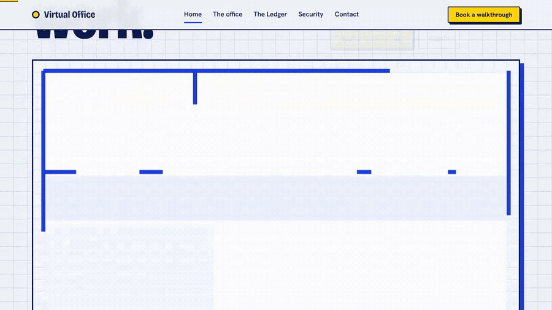
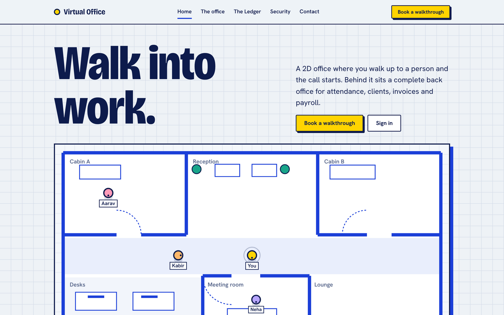
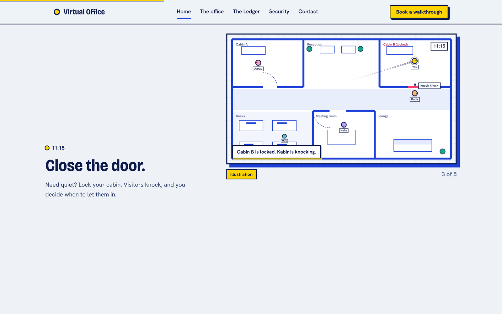
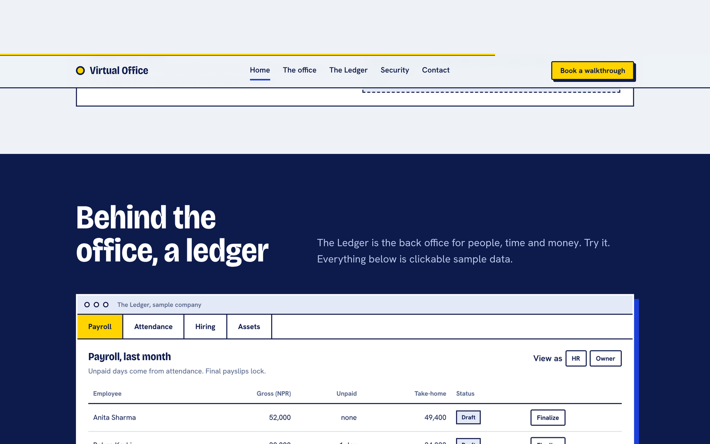
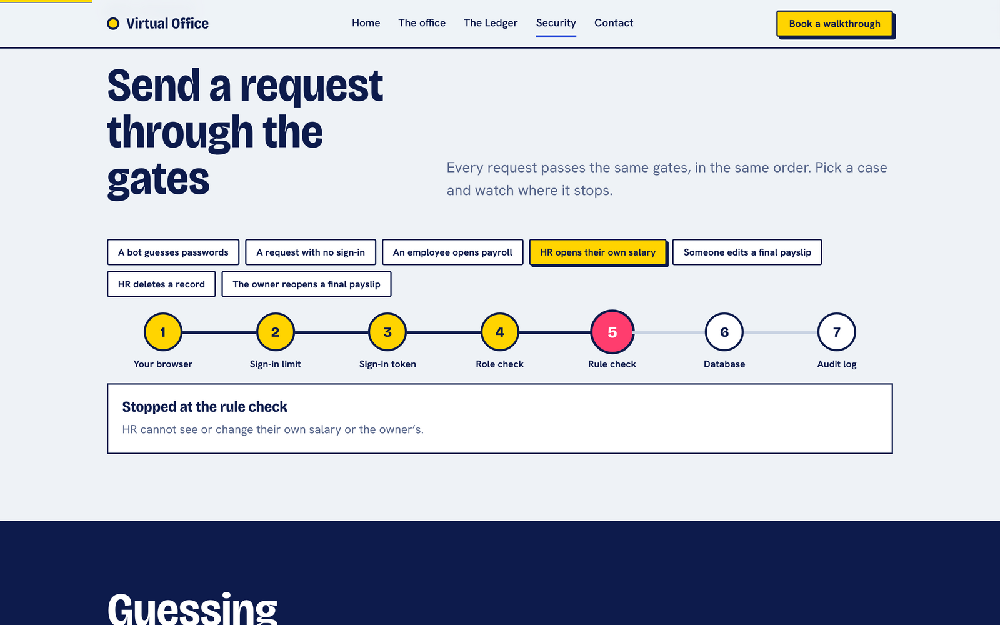
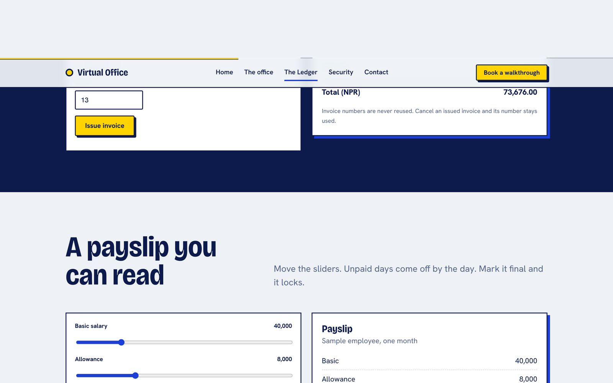

# Virtual Office

A 2D virtual office where you walk up to a person and the call starts, with a complete back office behind it. Built for teams in Nepal and India.

> The source code of the full product is private. This repository is the public showcase: screenshots, the design, and how it is built. A live walkthrough is available on request.

## What it does

**The office**

- A floor plan with cabins, desks, a meeting room and a lounge. Avatars walk around in real time.
- Step into a cabin, or stand next to a colleague, and a video call starts. Step away and it ends.
- Cabins have doors. Lock yours and visitors have to knock.
- Invite-only meetings, availability status, and a low-bandwidth mode for weak connections.
- Short written summaries of meetings.

**The Ledger, the back office**

| People | Time | Money | Company |
| --- | --- | --- | --- |
| Employees and roles | Attendance register | Clients | Notice board |
| Invite links | Leave and balances | Projects | Hiring pipeline |
| Audit log | Holidays | Invoices with VAT | Assets |
| | | Salary, payroll, payslips | |

Dates can be shown in AD or BS.

## Screenshots

| | |
| --- | --- |
|  |  |
|  |  |

## Rules the system enforces

These are the details I care about most, because they are where back-office software usually goes wrong.

- **Money is stored in whole paise**, never as floating point, so totals do not drift.
- **Invoice numbers are never reused**, even after an invoice is cancelled.
- **Payslips keep the salary as it was on the day they were made.** A later raise does not rewrite history.
- **A month can be finalized only after it is over.** Final payslips are locked, and only the owner can reopen one.
- **Pay is private.** HR cannot see or change their own salary or the owner's. An employee opens only their own payslips.
- **Unpaid days are suggested from attendance**, and HR can edit them before finalizing.
- **A job has a seat limit**, and the same email cannot apply twice to one job.
- **An asset that was ever given out cannot be deleted.** It is retired instead.
- **The audit log records who did what and when. It never records amounts.**

## How it is built

- **Backend:** Node.js, Express 5, Socket.io for real-time movement, MongoDB with Mongoose
- **Auth and safety:** bcrypt password hashing, JWT sessions, role checks on every route, rate limiting, security headers, server-side removal of someone from a call
- **Video:** LiveKit
- **Front end:** Phaser 3 for the office, plain JavaScript for the back office
- **Back office design:** each module is a small plugin that registers its own page and API, so a new module does not touch the others
- **Quality:** hundreds of automated API checks across payroll, hiring, assets, notices and more, plus browser tests that click through the real pages
- **Deploy:** one `PORT`-aware server with a health check, a Dockerfile, and refusal to start in production with a weak secret

## Status

In active development. Not yet built: two-step sign-in, single sign-on, several companies in one installation, and email invites with password reset. Several of these are on the roadmap.

## About

Built by **Pranjali Singh**, a BCA graduate from Nepalgunj, Nepal, as a way to learn a modern real-time stack end to end while building something people could actually use.

Interested in a walkthrough? Message me on [LinkedIn](https://www.linkedin.com/in/pranjali-singh-08053236b).
